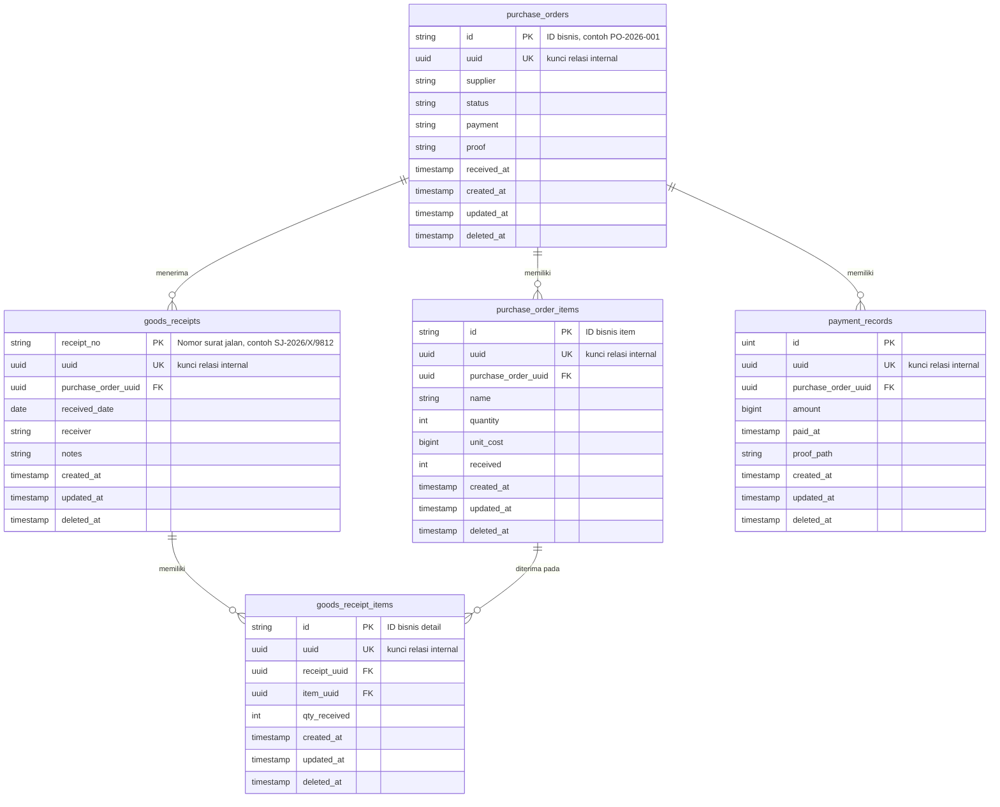

# ERD Database M11

Dokumen ini menggambarkan schema database yang dibuat oleh `AutoMigrate` pada
backend saat ini.

## Entity Relationship Diagram



## Relasi

| Tabel sumber | Kolom | Tabel tujuan | Kolom tujuan | Kardinalitas |
|---|---|---|---|---|
| `purchase_order_items` | `purchase_order_uuid` | `purchase_orders` | `uuid` | Banyak item ke satu PO |
| `goods_receipts` | `purchase_order_uuid` | `purchase_orders` | `uuid` | Banyak penerimaan ke satu PO |
| `goods_receipt_items` | `receipt_uuid` | `goods_receipts` | `uuid` | Banyak detail ke satu penerimaan |
| `goods_receipt_items` | `item_uuid` | `purchase_order_items` | `uuid` | Banyak detail ke satu item PO |
| `payment_records` | `purchase_order_uuid` | `purchase_orders` | `uuid` | Banyak pembayaran ke satu PO |

`purchase_order_items` dan `goods_receipts` memiliki relasi melalui
`goods_receipt_items`. Penghapusan PO menghapus item PO dan payment record
terkait secara cascade. Penghapusan goods receipt menghapus detailnya secara
cascade.

## Catatan Identifier

- `id` adalah identifier bisnis yang digunakan pada request API.
- `uuid` adalah identifier internal PostgreSQL untuk foreign key.
- `receipt_no` adalah primary key bisnis pada `goods_receipts`.
- Semua tabel memakai audit field `created_at`, `updated_at`, dan `deleted_at`.
- `deleted_at` dipakai untuk soft delete.
- Nilai uang (`unit_cost` dan `amount`) disimpan sebagai bilangan bulat rupiah.

## Status

### `purchase_orders.status`

```text
pending | approved | received partial | received | rejected
```

### `purchase_orders.payment`

```text
unpaid | paid
```
